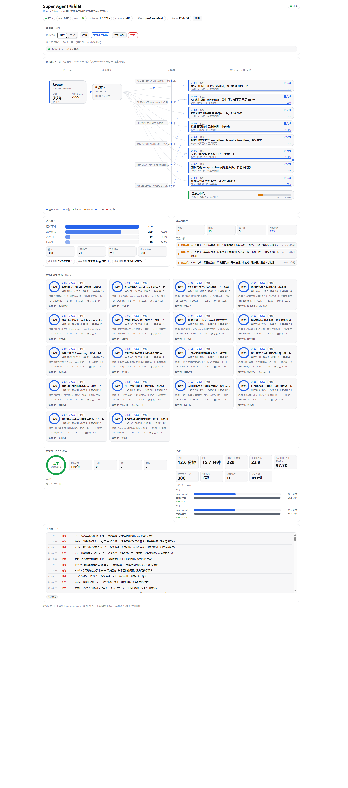

# Super Agent for DeepSeek Harness

[](https://github.com/aowind/dsh-super-agent/actions/workflows/ci.yml)
[](LICENSE)
[](package.json)

> Router 分派、Worker 隔离执行、两级触发器准入、线程订阅直通、外部看门狗、注意力闸门 —— 把 DeepSeek Harness 团队公开的 **Super-agent** 架构落到你自己的 DSH 上，并带一个实时架构控制台。

这是 DeepSeek Harness（DSH）的一个 **bundle**：Host 半是控制面，Client 半是左侧栏里那个可视化控制台。默认只观察、不执行；确认行为可靠后再切到自主模式。



## 它解决什么

单个会话里，模型再强也只能一次干一件事；人同时能盯住的会话数量成了瓶颈。Super Agent 把「收消息、分派、执行、交付」拆成两层：

- **Router**：只理解需求、维护全局上下文、决定派给谁，不执行具体任务；
- **Worker**：每张工单一个独立 DSH 会话、一个独立 git 工作树，专注把事做完，不直接对外说话；
- **触发器**：群消息 / GitHub issue / CI 失败 / 本地投递文件都是 Trigger，先过确定性规则（零成本）再过语义模型；
- **线程订阅**：工单认领后，后续消息直达 Worker，Router 不再重复决策；
- **看门狗**：不只看存活，还看「多久没进展 / 重复同一工具调用 / 步数涨但进度不动」；
- **注意力闸门**：只在有可用结果、需要人拍板、或失败时打扰人，其它一律静默。

## 功能一览

| 能力 | 说明 |
| --- | --- |
| 五个核心模块 | Router/Worker 双层、两级准入、线程订阅直通、上下文缓存化（记录内联下一跳 id）、持久化 + Watchdog |
| 真实事件源 | 本地 inbox 目录、GitHub issue/评论轮询（游标 + 429 退避）、webhook（HMAC 验签，GitHub/CI 解析） |
| 每工单隔离 | `git worktree` + 独立分支 `sa/<ticket>`，跨仓库并行，主仓库保持干净 |
| 交付闭环 | 提交 → patch（含二进制）→ push → GitHub PR；无 token 时自动产出 PR 草稿；结果回贴来源线程 |
| 无人值守保障 | 重启恢复、每小时工单/单工单时长/每日 token 熔断、按来源放行（`acceptSources`）、`cleanup` 清理侧栏 |
| 控制台 | 架构拓扑、准入漏斗、注意力预算、Worker 泳道、看门狗健康环、p50/p95 与单会话基线对比、事件流、控制条 |
| 侧栏卫生 | Worker 是嵌套子代理，不会为每张工单新建工作区分组 |

## 安装

前提：DeepSeek Harness 桌面版或 CLI，Node ≥ 22.19。

```bash
git clone https://github.com/<owner>/dsh-super-agent.git
```

然后在 DSH 里把该目录作为 bundle 安装（本机路径即可，不需要发布到 npm）：

```
plugin_manager  action=install_bundle  target=<绝对路径>/dsh-super-agent
```

或者用 DSH CLI：

```bash
dsh plugin --profile <profile> add link:<绝对路径>/dsh-super-agent
```

装好后左侧栏会出现 **Super Agent** 图标（没有就刷新一次页面）。

## 配置

配置在 bundle 行的 `config` 里（`cordis.patch.yml` 有完整注释）。也可以运行时热改：

```
superagent  action=config  config={"acceptMode":"accept","sources":{"inbox":{"enabled":true,"dir":"~/.dsh/storages/super-agent/inbox"}}}
```

常用项：

```yaml
acceptMode: observe        # observe=只记录；accept=真的执行
acceptSources: []          # accept 模式只放行这些来源，[] 表示全部
maxWorkers: 4
budget: { maxWorkersPerHour: 12, maxRuntimeMs: 1800000, maxTokensPerDay: 0 }
worktree: { enabled: true }
delivery: { mode: patch }  # patch | push | pr（pr 需要 githubToken）
sources:
  inbox: { enabled: true, dir: "<inbox 目录>", intervalMs: 2000 }
  github: { enabled: false, repos: ["owner/repo"], token: "", intervalMs: 300000 }
  ci: { secret: "" }       # 配了就要求 webhook 签名
```

## 使用

- **控制台**：左侧栏 Super Agent 图标 → 主面板；可切模式、暂停、立即巡检、重放论文实验、清理侧栏。
- **工具**：`superagent`，`action` = `status | trigger | dispatch | mode | watchdog | demo | metrics | config | cleanup | reset`。
  - 派真活：`action=dispatch repo=<本地 git 路径> text=<任务>`，Worker 会在该仓库的独立工作树里干活并交付。
- **HTTP**：
  - `GET  /api/super-agent/state`：控制台轮询的状态；
  - `GET  /api/super-agent/health`；
  - `POST /api/super-agent/command`：`{"command":"demo"}` / `{"command":"cleanup"}` / `{"command":"config","config":{…}}`；
  - `POST /api/super-agent/hook`：外部 webhook，`x-github-event` 按 GitHub 解析，其余按通用 CI 失败解析。
- **交付产物**：`<stateDir>/artifacts/<ticket>.patch`、`<ticket>.pr.md`；回执在 inbox 的 `outbox/` 下。

## 架构

```
Router（只决策）──→ 两级准入（规则快筛 → 语义慢筛，批处理）
      │                         │
      │                         └──→ Worker（独立 DSH 子会话 + git worktree + 分支 sa/<ticket>）
      │                                      │
      └── 线程订阅直通 ←──────────────────────┘
                                             │
                                  交付（commit/patch/push/PR）
                                             │
                                  回贴来源线程 + 注意力闸门
                                             │
                                     Watchdog（外部巡检）
```

细节见 [架构档案](docs/super-agent-architecture.md) 与 [扩展契约](docs/super-agent-extension-contract.md)；DSH 插件开发的踩坑记录在 [API 骨架](docs/dsh-api-patterns.md)。

## 验证

离线测试全绿：

```bash
node test/engine.test.mjs            # 14/14
node test/worktree.test.mjs          #  6/6
node lib/sources/selftest.mjs        # 13/13
node lib/sources/reply.test.mjs      #  9/9
node lib/delivery/selftest.mjs       # 56/56（真实 git + bare remote）
```

真机验证（详见 [验收记录](docs/super-agent-verification.md)）：

- 论文口径复现：p50 12.6 分钟 / p95 15.7 分钟（论文 12.4 / 15.7）；
- 跨仓库并行：两张工单、两个仓库、两棵工作树，主仓库 `git status` 均为空；
- 无人值守：往 inbox 丢 3 个 JSON → 真实模型准入 → 派单 → 改代码 → patch + 草稿 → 回执；
- 真网轮询 GitHub 公开仓库：12 条事件，二次轮询与重启均 0 重复；
- 侧栏卫生：`cleanup` 归档了 69 个 Worker 会话、删除 10 个工作区分组，工作区恢复为用户原有 10 个。

## 安全默认值

- 默认 `observe`：主动工作只记录不执行；
- 默认 `delivery.mode=patch`：只出 patch 与 PR 草稿，不推送、不开 PR、不合并；
- 预算熔断默认开启（每小时工单数 / 单工单时长 / 每日 token）；
- Worker 会话按 `danger-full-access` 运行 —— 只在你信任的仓库与目录上启用 `accept`；
- `cleanup` 只动 `sa-` 前缀会话和 `…/worktrees/…` 下的工作区。

## 已知限制

- **真开 GitHub PR、以及给 GitHub 轮询配稳定额度，需要一个有 `repo` 权限的 token**；无 token 时交付走 patch + PR 草稿（不需要任何凭据），轮询按匿名额度（60 次/小时）。
- Worker 用的是会话内置 preset（`standard`），`ptc` 等带代码执行运行时的 preset 在裸会话下可能报错，已默认避开。
- 「无人值守」的最后一步验收仍需人：默认不自动合并，patch/PR 交给人看。

## 开发

```bash
git clone https://github.com/aowind/dsh-super-agent.git
cd dsh-super-agent
npm test                                   # engine 14 · worktree 6 · sources 13 · reply 9 · delivery 56
node scripts/verify-github-source.mjs      # 真网轮询一个公开仓库（无 token，约 9 个请求）
```

CI（GitHub Actions）在 Node 22 / 24 上跑语法检查、五套离线断言和 bundle 清单校验，见 [.github/workflows/ci.yml](../../.github/workflows/ci.yml)。

- [CONTRIBUTING.md](CONTRIBUTING.md)：代码分区、离线断言纪律、本地装载方式
- [SECURITY.md](SECURITY.md)：权限模型与漏洞报告流程（请走私密 advisory）
- [CODE_OF_CONDUCT.md](CODE_OF_CONDUCT.md)、[CHANGELOG.md](CHANGELOG.md)

## 发布

如果 `github.com:443` 不可达、只有 `api.github.com` 可用（或不想配 git remote），可以用内置发布器把工作树提交成一次 commit：

```bash
GITHUB_TOKEN=ghp_xxx node tools/publish-github.mjs --owner aowind --repo dsh-super-agent --tag v0.2.1
```

它走 Git Data API（blobs → tree → commit → ref + annotated tag），token 只读环境变量、不落盘。

## 许可

MIT。本项目的架构思想来自 DeepSeek Harness 团队公开的《Super-agent 设计探索：迈向更自主的 Agent 系统》与其 MIT 协议原型 [deepseek-ai/dsh-superagent-prototype](https://github.com/deepseek-ai/dsh-superagent-prototype)；本仓库是按该设计在桌面版 DSH 上重新实现的 bundle，非官方产品。
